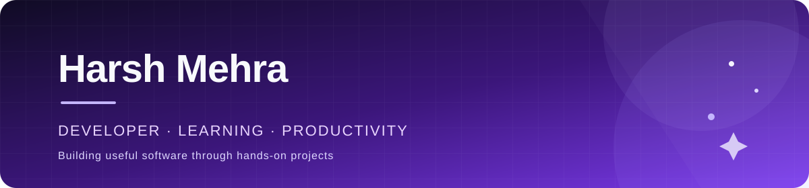

  
   
  

---

## About

I'm Harsh Mehra, a developer working on useful software, including tools for study and productivity. I enjoy learning by building and sharing projects.

## Featured projects

<table>
  <tr>
    <td width="50%">
      <h3><a href="https://github.com/HARSH-MEHRAA/PERSONAL-WORKSPACE-AI">Personal Workspace AI</a></h3>
      
A smart study and productivity assistant.

      
    </td>
    <td width="50%">
      <h3><a href="https://github.com/HARSH-MEHRAA/vibe-coding-platform">Vibe Coding Platform</a></h3>
      
A TypeScript project with a live site.

      
      
    </td>
  </tr>
</table>

## What I'm focused on

- Building software for learning and productivity
- Exploring AI-powered tools through hands-on projects

---

  <a href="https://github.com/HARSH-MEHRAA">GitHub</a>
  &nbsp;·&nbsp;
  <a href="https://github.com/HARSH-MEHRAA?tab=repositories">Projects</a>

